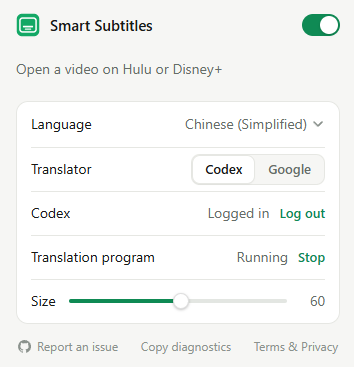

# Smart Subtitles

[English](#english) | [中文](#中文)

## English

Smart Subtitles is a bilingual subtitle extension for Hulu and Disney+, including Hulu content on Disney+. It translates English subtitles with Codex or Google and displays the translation alongside the original.

[Chrome Web Store](https://chromewebstore.google.com/detail/bpfhbkkdmommobklkndkfagejfpbnjno) · [Downloads](https://github.com/jinzhou5042x/smart-subtitles/releases) · [Issues](https://github.com/jinzhou5042x/smart-subtitles/issues)



Supports 55 target languages, adjustable text size and draggable subtitles. Translations are cached locally. Videos must have English subtitles; Netflix, YouTube and live TV are not supported yet.

### Installation

Requires Chrome 127+ and Windows x64 or macOS 13+. Install both the extension and the translation program:

1. Install the extension from the Chrome Web Store.
2. Download the translation program for Windows x64, Mac Apple Silicon (`darwin-arm64`) or Mac Intel (`darwin-x64`). Extract the ZIP and keep the folder.
3. Run **Set Up Codex.cmd** on Windows or **Set Up Codex.command** on Mac. Complete the ChatGPT sign-in.
4. Open a video, click the extension icon, and select a **Language**. Turn on the top-right switch. Click **Connect** if prompted.

Subtitles appear as translation progresses. After setup, the extension starts the translation program automatically. The download includes the required runtime; no developer tools are needed.

If you move the program folder, run **Start Subtitles** from the new location. On Mac, a blocked launcher can be opened through Finder's **Open** action or **System Settings → Privacy & Security**, after checking that you trust the download.

### Translators

**Codex** uses your ChatGPT login and translates with episode context. The default model is **GPT-6 Luna** (`gpt-6-luna`), with reasoning effort set to **low** to limit reasoning-token use. Translation shares your Codex allowance with other usage.

A plan with GPT-6 Luna access in Codex is required. Plus is listed at **US$20/month**; see [OpenAI's pricing](https://learn.chatgpt.com/docs/pricing) for current access and rates. Smart Subtitles itself is free.

**Google Cloud Translation** translates each subtitle separately using your API key. Usage is billed to your Google Cloud account. Release packages default to Codex only; see [For developers](#for-developers) to enable Google. For Google-only setup, skip **Set Up Codex** and run **Start Subtitles** once instead.

#### How to get a Google Translate API key

Google's tutorials: [Set up Cloud Translation](https://docs.cloud.google.com/translate/docs/setup) and [Create an API key](https://docs.cloud.google.com/docs/authentication/api-keys#create).

1. Sign in to [Google Cloud Console](https://console.cloud.google.com/) and create a project.
2. Link a billing account, then enable **Cloud Translation API** under **APIs & Services → Library**.
3. Go to **APIs & Services → Credentials → Create credentials → API key**.
4. Restrict the key to **Cloud Translation API**, save, and copy the key.
5. Paste only the key into a text file. In Smart Subtitles, select **Google → Choose file…** and open that file.

Google requires billing for Cloud Translation. Keep the key private and keep its file in the same location.

### Usage

- Change **Size** to resize subtitles; drag them vertically to reposition them. The position is saved.
- The top-right switch controls the extension's subtitles. Turn off the player's own captions separately if they overlap.
- Translations are saved per language and translator. Closing a video stops its translation; reopening resumes from saved progress.
- **Translate again** retranslates a finished title and uses your allowance again. New subtitles appear progressively. If interrupted, the previous translation is restored; the saved copy is replaced only when the new one finishes.
- **Stop** stops the translation program; **Connect** restarts it.
- **Log out** also affects other apps using the same Codex login on this computer.

Subtitles are hidden during ads. If Disney+ asks for a sync interaction, move the pointer over the video or pause once. Refresh video pages after updating the extension.

### Troubleshooting

**Cannot connect:** run **Start Subtitles** from the program folder, then click **Connect**. Run **Check Environment** in that folder if the problem continues.

**No subtitles:** check that the switch is on and the video has English subtitles. The extension shows installation, sign-in, key-file and quota errors. Run **Set Up Codex** if Codex is missing; use **Log in** if signed out.

For other problems, open an [issue](https://github.com/jinzhou5042x/smart-subtitles/issues) with the output of **Copy diagnostics**, your OS, browser and extension versions, and steps to reproduce. Remove keys and login information before posting.

Windows has the most live testing. macOS, ad-supported plans and long sessions need more coverage.

### Data

Subtitles, translations, settings and logs are stored on your computer. Text for translation is sent directly to OpenAI through Codex or to Google under your account. Smart Subtitles has no backend, accounts, analytics or tracking.

To delete cached translations and logs, stop the program and remove its `data` and `logs` folders. To uninstall, remove the extension and stop the program. [Terms & Privacy](https://jinzhou5042x.github.io/smart-subtitles/).

### Planned

- DeepSeek, Claude and Qwen translators
- Local model support
- More streaming sites

These are not implemented yet. Issues and pull requests are welcome, including translation corrections and testing on other platforms. Please discuss new translator or site integrations in an issue before starting a large change.

### For developers

Install **Git and Node.js 22.13+**. On macOS, also install Xcode Command Line Tools for the native file picker. Clone and build:

```sh
git clone https://github.com/jinzhou5042x/smart-subtitles.git
cd smart-subtitles
npm run build
```

1. Run **Set Up Codex.cmd** / **Set Up Codex.command** for Codex installation and sign-in.
2. Open `chrome://extensions`, enable **Developer mode**, choose **Load unpacked**, and select `dist/extension`.
3. Copy that extension's ID. Create or update `config/local.json`, preserving existing settings, with `"extensionIds": ["YOUR_UNPACKED_EXTENSION_ID"]`.
4. Run **Start Subtitles.cmd** / **Start Subtitles.command** to register the browser connection and start the program.
5. After changes, run `npm run build`, reload the extension, and refresh the video page.

To enable Google, merge `"providers": ["codex", "google"]` into `config/local.json`, then restart the translation program. This file is private and ignored by Git. Select the key file through the extension. Model and reasoning overrides also belong here (`model` and `effort`).

```sh
npm test
npm run check:browser
npm run package
npm run release
```

`package` writes the Chrome Web Store ZIP to `dist/store/`; `release` builds the translation-program archive for the host platform. Build macOS archives on macOS. Site adapters live in `extension/players/`, the site registry in `extension/sites.js`, translation code in `service/`, and tests in `tests/`. Keep keys, local configuration, logs and user data out of commits.

---

## 中文

Smart Subtitles 是一个双语字幕扩展，目前支持 Hulu 和 Disney+，包括 Disney+ 中的 Hulu 内容。使用 Codex 或 Google 翻译英文字幕，并与原文同时显示。

[Chrome 应用商店](https://chromewebstore.google.com/detail/bpfhbkkdmommobklkndkfagejfpbnjno) · [下载](https://github.com/jinzhou5042x/smart-subtitles/releases) · [反馈问题](https://github.com/jinzhou5042x/smart-subtitles/issues) · [界面截图](docs/store/assets/promo-original.png)

支持 55 种目标语言，可调字号、拖动字幕位置，译文缓存在本机。视频必须有英文字幕；暂不支持 Netflix、YouTube 和直播电视。

### 安装

需要 Chrome 127+，以及 Windows x64 或 macOS 13 及以上。扩展和翻译程序都需要安装：

1. 从 Chrome 应用商店安装扩展。
2. 下载对应系统的翻译程序：Windows x64、Mac Apple Silicon（`darwin-arm64`）或 Mac Intel（`darwin-x64`）。完整解压 ZIP，保留文件夹。
3. Windows 运行 **Set Up Codex.cmd**，Mac 运行 **Set Up Codex.command**，按提示完成 ChatGPT 登录。
4. 打开视频，点击扩展图标，在 **Language** 中选择语言，打开右上角开关。若显示 **Connect**，点击连接。

字幕会随翻译进度出现。首次配置完成后，扩展会自动启动翻译程序。下载包自带运行环境，不需要安装开发工具。

移动程序文件夹后，需要在新位置运行一次 **Start Subtitles**。Mac 若拦截启动文件，确认下载来源可信后，可通过 Finder 的“打开”或“系统设置 → 隐私与安全性”放行。

### 翻译器

**Codex** 使用自己的 ChatGPT 登录，结合整集上下文翻译。默认模型为 **GPT-6 Luna**（`gpt-6-luna`），推理强度设为 **low**，以减少推理 token 开销。翻译与其他 Codex 使用共享账号额度。

需要支持在 Codex 中使用 GPT-6 Luna 的套餐。Plus 标价为 **20 美元/月**，实际价格和权限见 [OpenAI 官方说明](https://learn.chatgpt.com/docs/pricing)。Smart Subtitles 本身免费。

**Google Cloud Translation** 使用自己的 API key，逐条翻译字幕，费用由 Google Cloud 账号承担。发行包默认只启用 Codex，开启 Google 的方法见[开发者](#开发者)。仅使用 Google 时，可跳过 **Set Up Codex**，改为运行一次 **Start Subtitles**。

#### 如何获取 Google Translate API key

Google 官方教程：[开通 Cloud Translation](https://docs.cloud.google.com/translate/docs/setup?hl=zh-cn)、[创建 API 密钥](https://docs.cloud.google.com/docs/authentication/api-keys?hl=zh-cn#create)。

1. 登录 [Google Cloud Console](https://console.cloud.google.com/)，新建一个项目。
2. 关联结算账号，在 **API 和服务 → 库** 中搜索并启用 **Cloud Translation API**。
3. 打开 **API 和服务 → 凭据 → 创建凭据 → API 密钥**。
4. 将密钥限制为仅用于 **Cloud Translation API**，保存并复制密钥。
5. 将密钥单独粘贴到文本文件中，在 Smart Subtitles 里选择 **Google → Choose file…**，打开这个文件。

Google 翻译 API 需要启用结算。密钥不要公开，保存后的文件不要随意移动。

### 使用

- **Size** 调整字号，在视频上上下拖动字幕可调整位置，位置会被保存。
- 右上角开关控制扩展字幕。如果与播放器原字幕重叠，需要单独关闭播放器字幕。
- 不同语言、翻译器的译文分别保存。关闭视频会停止翻译，重新打开后从已保存进度继续。
- **Translate again** 重新翻译已完成的视频，会再次消耗额度。重翻时逐步显示新字幕；中途停止则恢复旧译文，全部完成后才替换保存版本。
- **Stop** 停止翻译程序，**Connect** 重新启动。
- **Log out** 会影响本机其他共用同一 Codex 登录的应用。

广告期间字幕隐藏。Disney+ 提示同步时，将鼠标移到视频上或暂停一次。更新扩展后，请刷新视频页面。

### 常见问题

**无法连接：** 在程序文件夹中运行 **Start Subtitles**，再点 **Connect**。仍无法连接时，运行同目录的 **Check Environment**。

**没有字幕：** 检查开关和视频的英文字幕。安装、登录、密钥文件和额度问题会在扩展中显示。Codex 未安装时运行 **Set Up Codex**，未登录时点击 **Log in**。

其他问题请提交 [issue](https://github.com/jinzhou5042x/smart-subtitles/issues)，附上 **Copy diagnostics** 的结果、系统、浏览器和扩展版本，以及复现步骤。发布前去掉密钥和登录信息。

目前 Windows 实测较多，macOS、含广告套餐和长时间播放仍需要更多测试。

### 数据

字幕、译文、设置和日志保存在本机。翻译文本使用个人账号直接发送给 Codex 使用的 OpenAI 服务或 Google。Smart Subtitles 没有后台、账号系统、统计或跟踪服务。

清除翻译缓存和日志：停止程序，删除其目录中的 `data` 和 `logs` 文件夹。卸载时移除扩展并停止程序。详见[条款与隐私](https://jinzhou5042x.github.io/smart-subtitles/)。

### 计划

- 接入 DeepSeek、Claude、Qwen
- 支持本地模型
- 支持更多视频网站

以上尚未实现。欢迎提交 issue 和 PR，包括翻译纠错、文档修改和不同平台的测试反馈。新增翻译器或网站适配，建议先开 issue 讨论。

### 开发者

安装 **Git、Node.js 22.13 及以上**；macOS 还需 Xcode Command Line Tools，用于原生文件选择器。克隆并构建：

```sh
git clone https://github.com/jinzhou5042x/smart-subtitles.git
cd smart-subtitles
npm run build
```

1. 运行 **Set Up Codex.cmd** / **Set Up Codex.command** 安装并登录 Codex。
2. 打开 `chrome://extensions`，启用开发者模式，选择“加载已解压的扩展程序”，加载 `dist/extension`。
3. 复制该扩展 ID，在 `config/local.json` 合并 `"extensionIds": ["你的扩展ID"]`，保留已有设置。
4. 运行 **Start Subtitles.cmd** / **Start Subtitles.command** 注册连接并启动程序。
5. 修改后运行 `npm run build`，重新加载扩展并刷新视频页。

启用 Google：在 `config/local.json` 合并 `"providers": ["codex", "google"]`，重启程序，再通过扩展选择密钥文件。该配置不提交 Git；模型及推理强度也可在此通过 `model`、`effort` 调整。

验证与打包命令为 `npm test`、`npm run check:browser`、`npm run package`、`npm run release`。扩展 ZIP 输出到 `dist/store/`；翻译程序按当前平台构建，macOS 包需在 macOS 构建。网站适配器位于 `extension/players/`，网站注册表位于 `extension/sites.js`，翻译代码位于 `service/`，测试位于 `tests/`。请勿提交密钥、本机配置、日志或用户数据。

---

Unofficial; not affiliated with Hulu, Disney or other streaming services. For personal, non-commercial use.
本项目与上述流媒体服务无隶属关系，仅供个人非商业使用。
